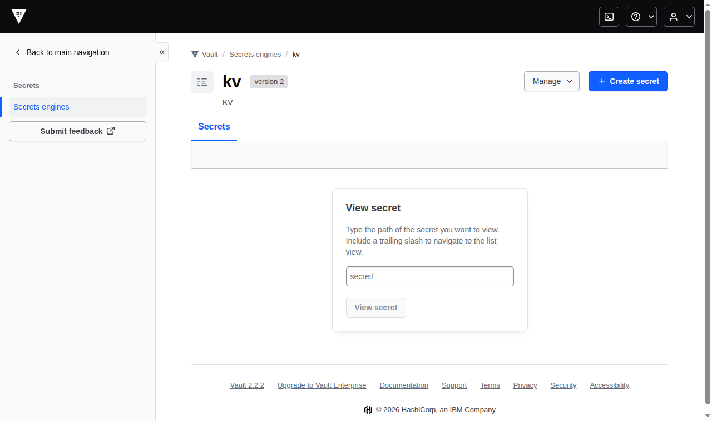
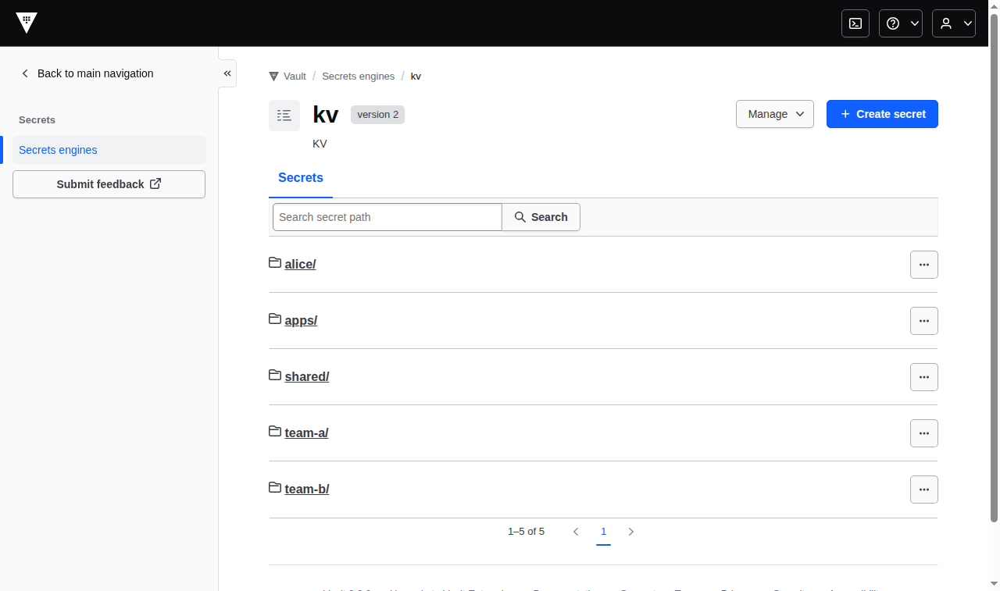

# vault-kv-reach

Shows which KV secrets a HashiCorp Vault or OpenBao token can reach, also when
the token has no `list` capability on the parent folders. Two parts:

- `vault-kv-reach tree`: walks all KV mounts the token can see and prints every
  secret, folder and wildcard pattern it can reach, with capabilities.
- `vault-kv-reach proxy`: a reverse proxy in front of Vault. When Vault answers
  a `LIST` on a KV folder with 403, the proxy answers instead with the names the
  token's policies grant below that folder. Users can then click through to
  their secrets in the Vault UI or list them with the CLI.

Both use only the token itself (no admin token): `sys/internal/ui/mounts`,
`sys/internal/ui/resultant-acl` and `sys/capabilities-self`.

## Why

A common way to scope KV access is a policy like

```hcl
path "secret/data/team-b/config" { capabilities = ["read"] }
```

The user can read `team-b/config`, but `LIST secret/metadata/` and
`LIST secret/metadata/team-b/` return 403. In the UI and the CLI they have to
know and type the full path. Granting `list` on the parents is not a fix,
because `list` shows every name in the folder, also those of other teams.

- [hashicorp/vault#5362](https://github.com/hashicorp/vault/issues/5362)
  "List all secret paths a user has permission to view": 106 reactions,
  59 comments, open since 09/2018. HashiCorp in 12/2023: "List-based
  permissions (that is, only listing items a user has access to) is still in
  the works." Comments from 10/2025 still ask for it. A 2023 UI change
  (#22502) lets users type a path they cannot list, which the reporters say
  does not solve it.
- [hashicorp/vault#8367](https://github.com/hashicorp/vault/issues/8367)
  "Listing only the user folder from a KV v2 engine" and
  [#23133](https://github.com/hashicorp/vault/issues/23133) "[UI] List (only)
  specific paths" are the same request.

Prior art: OpenShift CI runs a
[vault-subpath-proxy](https://github.com/openshift/ci-tools/tree/main/cmd/vault-subpath-proxy)
with the same idea for one KV mount. It lives in the OpenShift CI monorepo
and is not released on its own. vault-kv-reach is a standalone binary without
dependencies, handles all KV v1 and v2 mounts, `+` and `*` rules, templated
policies, and adds the `tree` command.

## Install

```sh
go install github.com/Jwrede/vault-kv-reach/cmd/vault-kv-reach@latest
```

Go 1.22 or newer, no other dependencies.

## Usage

```sh
export VAULT_ADDR=https://vault.example.com:8200
export VAULT_TOKEN=...        # or ~/.vault-token after `vault login`
vault-kv-reach tree           # all KV mounts
vault-kv-reach tree kv/team-a # one mount or prefix
vault-kv-reach tree -json     # one JSON object per line
```

`BAO_ADDR`, `BAO_TOKEN` and `~/.bao-token` work as well. `-namespace` sets
`X-Vault-Namespace`.

Proxy:

```sh
vault-kv-reach proxy -listen 0.0.0.0:8201 -upstream https://vault:8200 \
  -tls-cert proxy.crt -tls-key proxy.key
```

Point users (UI, `VAULT_ADDR`) at the proxy. Every request is passed through
unchanged; only a `LIST` (or `GET ?list=true`) on a KV v2 `metadata/` path or a
KV v1 path that Vault answered with 403 is replaced. The replaced response has
the header `X-Vault-Kv-Reach: derived`. Counters are at
`/-/vault-kv-reach/metrics`. Mounts and ACL of a token are cached for
`-cache-ttl` (10 s).

## Example

Policy of user `alice` (userpass), from the end-to-end test:

```hcl
path "kv/data/team-a/*"      { capabilities = ["read", "list"] }
path "kv/metadata/team-a/*"  { capabilities = ["read", "list"] }
path "kv/data/team-b/config" { capabilities = ["read"] }
path "kv/data/apps/+/token"  { capabilities = ["read"] }
path "kv/data/shared/readme" { capabilities = ["read"] }
path "kv/data/shared/*"      { capabilities = ["deny"] }
path "kv/data/hidden/*"      { capabilities = ["deny"] }
path "legacy/ops/db"         { capabilities = ["read"] }
path "kv/data/{{identity.entity.aliases.<userpass accessor>.name}}/*"     { capabilities = ["read"] }
path "kv/metadata/{{identity.entity.aliases.<userpass accessor>.name}}/*" { capabilities = ["read", "list"] }
```

`LIST kv/metadata/` with alice's token returns 403 from Vault; through the
proxy it returns `alice/ apps/ shared/ team-a/ team-b/`. In the Vault 2.2.2 UI
(screenshots from the CI run):

| Vault directly | Through vault-kv-reach proxy |
|---|---|
|  |  |
 `vault-kv-reach tree`
against Vault 2.2.2:

```
kv/ (kv v2)
  alice/  [from policy]
    notes  [read]
  apps/  [from policy]
    +/...  [pattern, not listable; read]
  shared/  [from policy]
    readme  [read; from policy]
  team-a/  [from policy]
    api  [list,read]
    db  [list,read]
    deep/
      x  [list,read]
  team-b/  [from policy]
    config  [read; from policy]
legacy/ (kv v1)
  ops/  [from policy]
    db  [read; from policy]
```

"from policy" means the name comes from a policy rule because the parent could
not be listed. `team-b/other`, `shared/private`, `hidden/x` and `bob/notes`
exist but are not shown.

## How it works

For a folder `F` in mount `M`, the proxy and `tree` first try a normal LIST.
On 403 they take the token's resultant ACL and collect every non-deny rule
that continues below `M/data/F` or `M/metadata/F` (KV v2) or `M/F` (KV v1),
matching `+` segments. The next segment of each rule becomes a key or a folder.
For each candidate a concrete path is checked with `sys/capabilities-self`
(for glob rules with a placeholder name), so a more specific `deny` removes it
again. Segments that are `+` or a name prefix (`db-*`) cannot be turned into
names; `tree` prints them as patterns, the proxy leaves them out.

## Tests

- Unit tests for rule parsing, child derivation, probes and path mapping.
- `e2e/run.sh` starts a dev server in Docker and runs `e2e/e2e_test.go`:
  KV v1 and v2 mounts, 16 secrets, a userpass user with the policy above.
  It checks that Vault itself returns 403 for the folders, that the proxy
  returns exactly the expected keys (LIST and `GET ?list=true`), that allowed
  LISTs, reads, root tokens and invalid tokens pass through unchanged, and
  compares the `tree` result with `sys/capabilities` for alice's token on
  every secret, asked with the root token.
- `e2e/ui/ui.mjs` logs into the web UI with alice's token in headless Chrome
  (DevTools protocol, no dependencies), once through the proxy and once
  directly. Through the proxy the mount page must list `alice/`, `shared/`,
  `team-a/`, `team-b/` and not `hidden/`, `bob/`, `top`, and `team-b/` must
  list `config` and not `other`; directly, `team-b/` must not appear.
- CI runs this against Vault 2.2.2, 1.21.4, latest and OpenBao 2.7.2, 2.5.5,
  latest, and weekly on Mondays.

## Limits

- Only names written in policies can be shown. `+` segments and prefix globs
  like `db-*` cannot be enumerated without `list`.
- OpenBao (checked: 2.5.5, 2.7.2) leaves rules with `+` out of
  `resultant-acl`, so such rules are not used there. The test detects this
  and checks the rest. Vault 1.21.4 and 2.2.2 report them.
- A derived name is shown when the policy grants something on it; the secret
  does not have to exist. `tree` checks existence only when the token can read
  the metadata.
- `resultant-acl` is an internal endpoint of Vault without stability promise.
- Namespaces are passed through but were not tested (Vault Enterprise,
  OpenBao namespaces).
- The UI test covers the KV list pages of the versions above. Other UI pages
  (for example other secrets engines) are passed through unchanged.
- The proxy is a policy-aware listing aid. It does not grant access: reads and
  writes still go to Vault with the user's token.

## License

MIT
